# Rain House

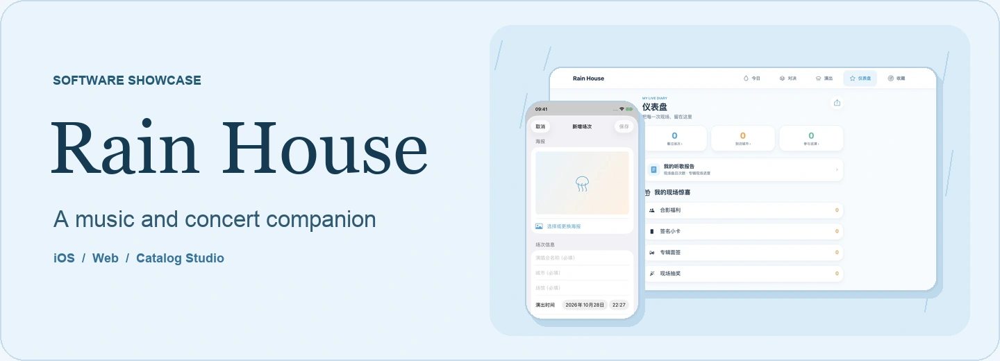

Rain House is a music and concert companion I built for iOS and the Web. It brings together daily lyric selections, favorites, pairwise song rankings, concert setlists, and an attendance diary. I also built a local Content Studio to maintain the catalog.

[Open Rain House on the Web](https://rainhouse.top)

## Screenshots & Demo

| iOS concert editor | Web backup and preferences |
| --- | --- |
| 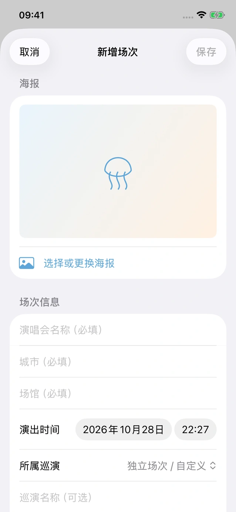 | 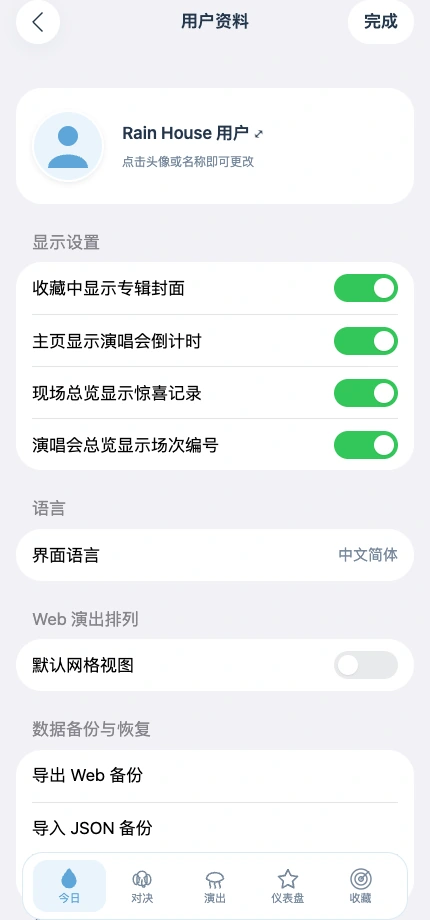 |

[Desktop attendance dashboard](assets/web-desktop-dashboard.webp) · [Setlist editor and history demo (MP4)](assets/catalog-workflow.mp4)

| Content Studio setlist editor | Edit history and restore |
| --- | --- |
| 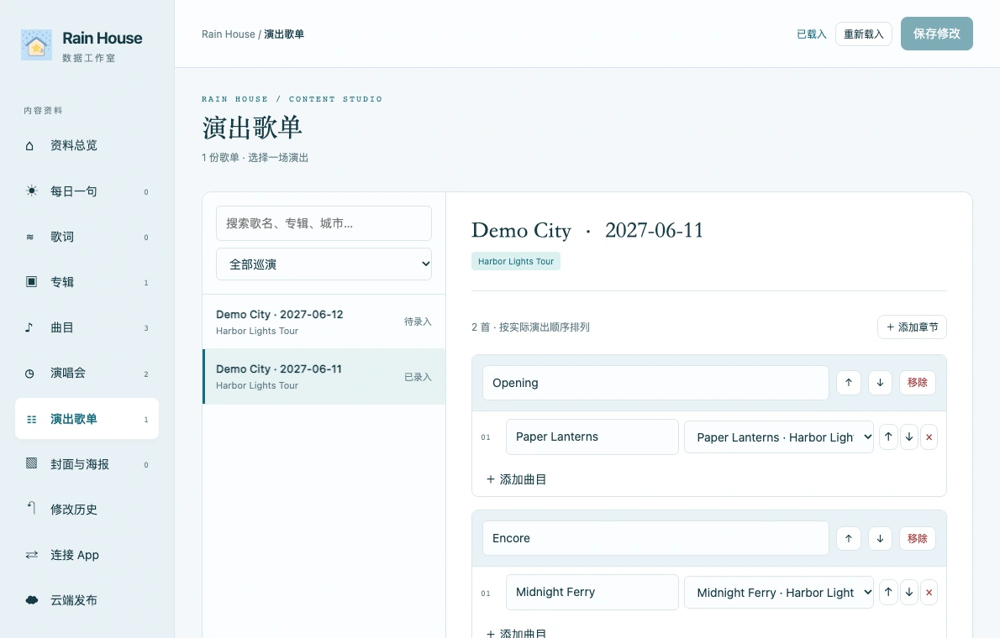 | 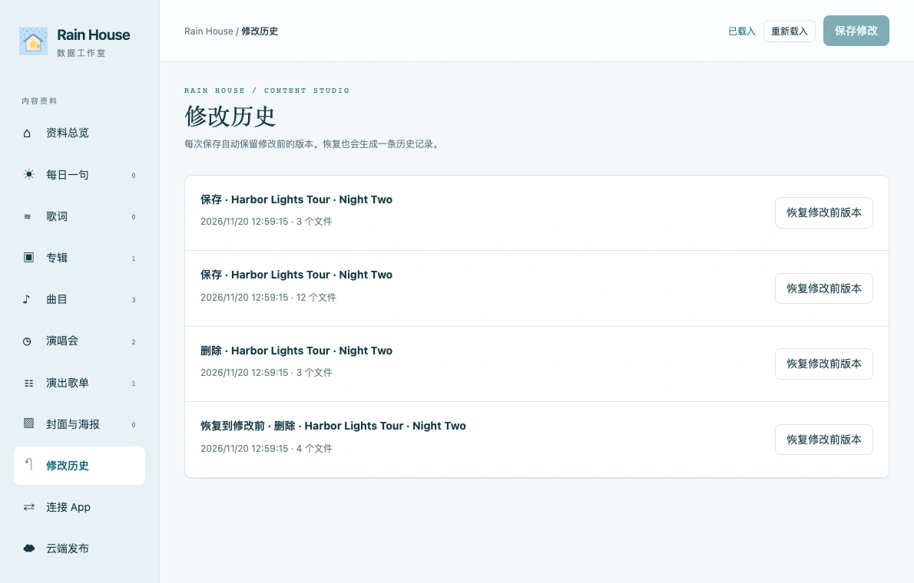 |

The Content Studio screens and demo use fictional catalog records.

### Mobile UI Boards

| App overview | Today, favorites, and sharing | Song comparisons and rankings |
| --- | --- | --- |
| [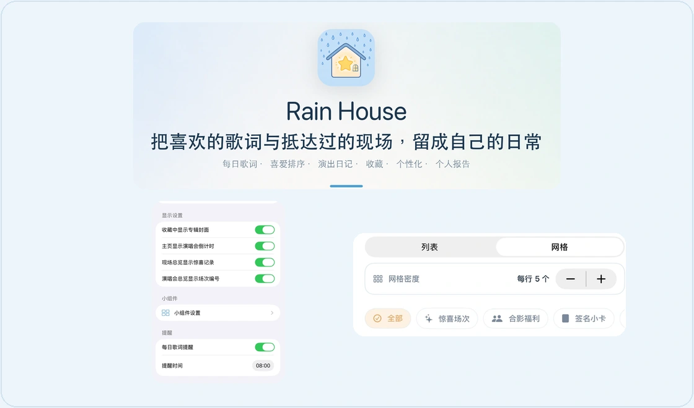](assets/mobile/overview.webp) | [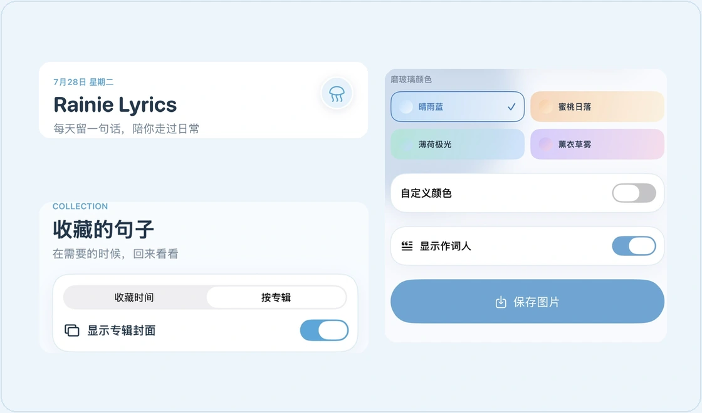](assets/mobile/today-and-favorites.webp) | [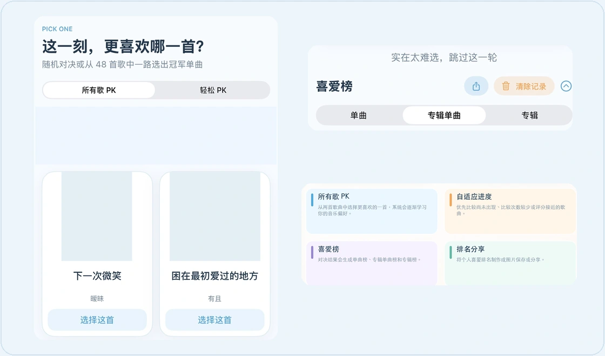](assets/mobile/song-ranking.webp) |
| **Concert diary** | **WidgetKit countdowns** | **Attendance dashboard** |
| [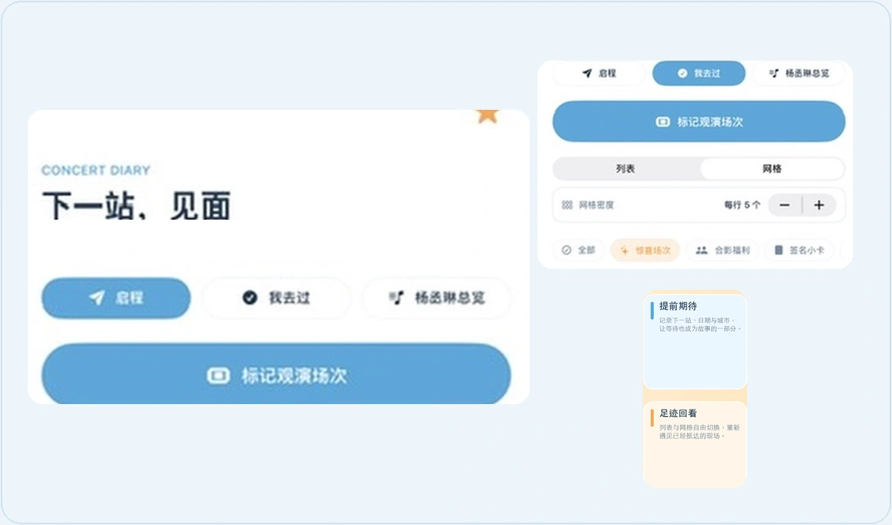](assets/mobile/concert-diary.webp) | [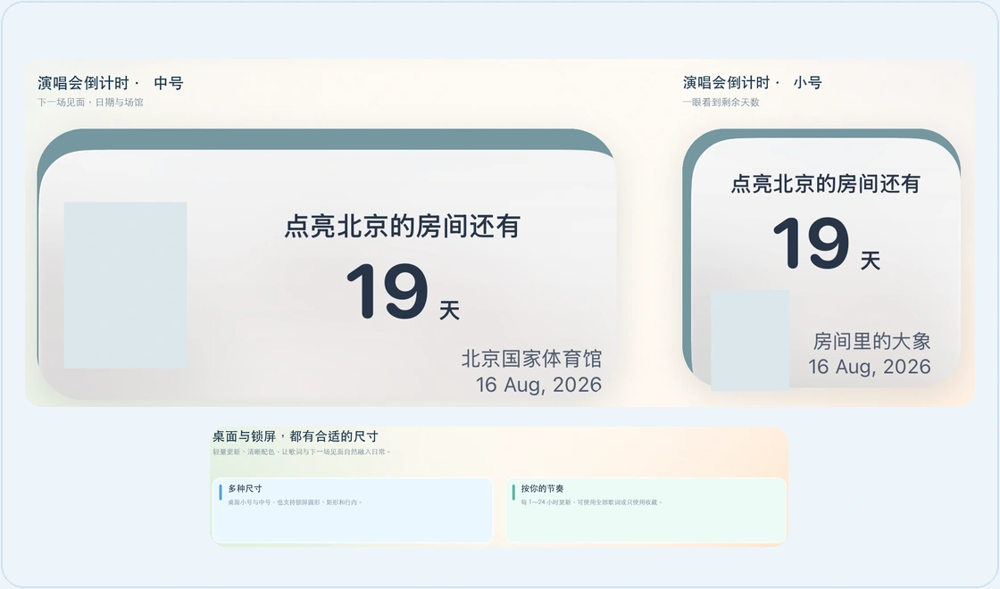](assets/mobile/widgets.webp) | [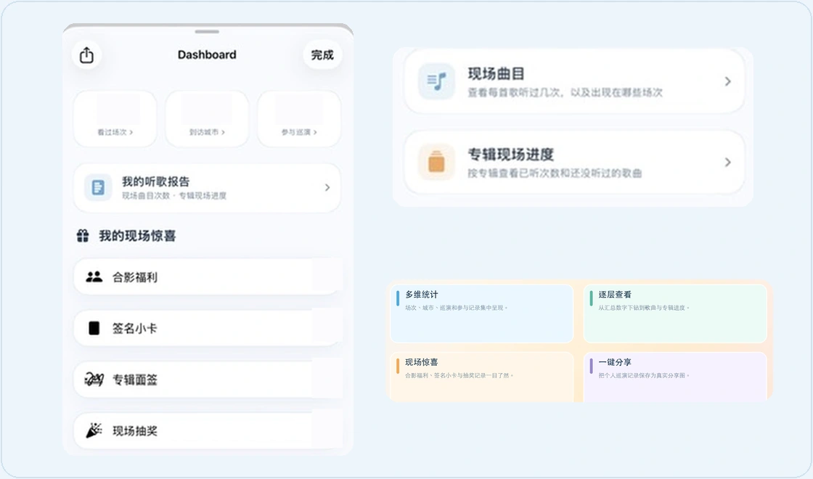](assets/mobile/attendance-dashboard.webp) |

Select a board to view it at full size. These excerpts omit album artwork, lyric text, and personal records.

## Implementation

- **iOS.** I built the app in Swift and SwiftUI, with a shared Swift package for the catalog, persistence, and Elo ranking logic. WidgetKit uses the shared data for daily lyrics and concert countdowns.
- **Web.** I built a responsive H5 app with TypeScript, React, and Taro. The layout adapts from mobile navigation to a desktop layout. Browser file and storage adapters handle imports, exports, and persistence.
- **Deployment.** I shipped the Web build on Cloudflare Pages and migrated the production site to EdgeOne Pages. The static build uses hash routing and content-hashed assets that can be cached independently of the HTML entry point.

## Database Design & Data Management

### Storage and data flow

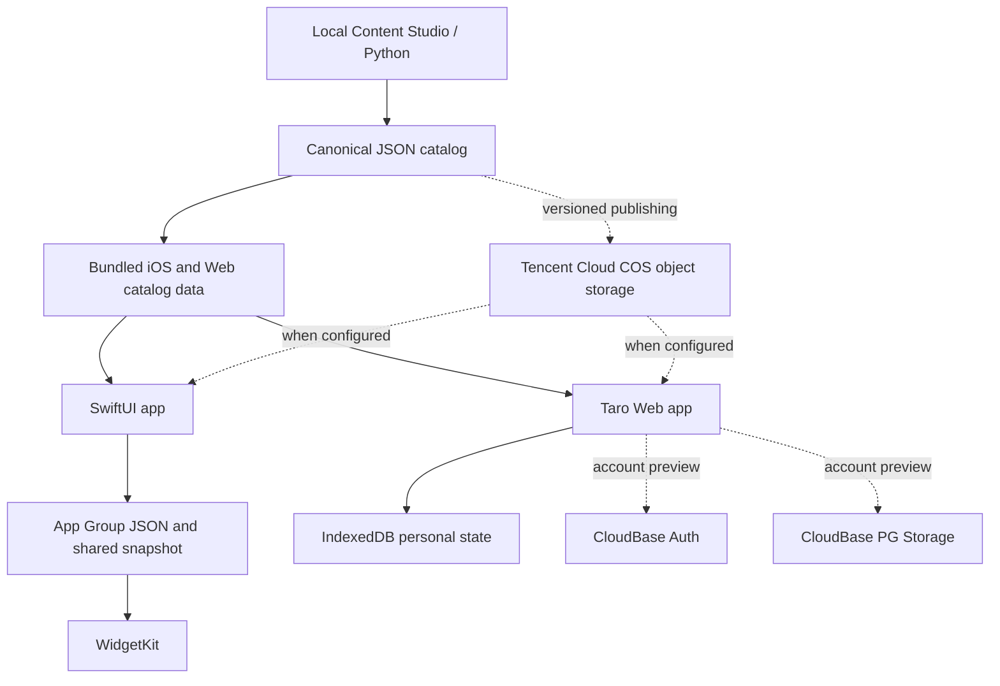

| Store | What it holds |
| --- | --- |
| **Editorial JSON** | Releases, tracks, lyric records, concerts, and ordered setlists. The studio writes the canonical files and refreshes local Web build inputs. |
| **iOS App Group and optional iCloud Drive** | Favorites, ratings, and concert records use atomic JSON writes. Preferences use UserDefaults. The app mirrors state to the App Group for WidgetKit when iCloud Drive is selected in a supported build. |
| **Web IndexedDB** | A versioned personal document holds state and preferences per browser origin. The Web app can import its own JSON backups and supported iOS backup exports. |
| **Tencent Cloud COS** | The catalog publisher writes immutable JSON snapshots and content-addressed images. It verifies uploaded objects before switching the active version pointer. Configured clients verify hashes before using a new snapshot and retain bundled or cached content on failure. |
| **CloudBase account preview** | CloudBase Auth handles sign-in. PostgreSQL-backed private Storage holds avatars with owner-scoped access. |

The live Web deployment uses its bundled catalog. CloudBase account integration was exercised in a separate development environment.

### Catalog and personal data model

These are JSON documents and ID references. The diagram shows the main links between records.

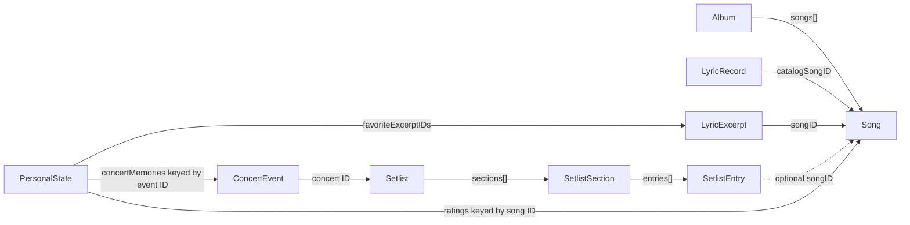

| Record | Selected fields |
| --- | --- |
| Album / Song | Album `id`, `title`, `releaseDate`, `kind`, and `songs`. Song `id`, `albumID`, `title`, and `trackNumber`. |
| LyricRecord / LyricExcerpt | A lyric record uses `catalogSongID` to link to a track. An excerpt has its own `id`, `songID`, and `dailyEligible` flag. |
| ConcertEvent / Setlist | A concert has `id`, `title`, `city`, `venue`, and `startsAt`. A setlist refers to `concertID` and contains ordered sections. An entry can link to a song or use a manual title. |
| PersonalState | `favoriteExcerptIDs`, `favoriteExcerptDates`, per-song `ratings`, and `concertMemories`. The backup wraps these records with a version and preferences. |

These two fictional records show the concert-to-setlist link.

```json
{
  "concert": {
    "id": "10000000-0000-4000-8000-000000000001",
    "title": "Harbor Lights Tour · Night One",
    "city": "Demo City",
    "venue": "Harbor Hall",
    "startsAt": "2027-06-11T19:30:00Z"
  },
  "setlist": {
    "concertID": "10000000-0000-4000-8000-000000000001",
    "sections": [
      {
        "id": "opening",
        "title": "Opening",
        "songIDs": ["demo-track-1"],
        "entries": [
          { "id": "entry-demo-1", "title": "Paper Lanterns", "songID": "demo-track-1" }
        ]
      }
    ]
  }
}
```

### Data management

I built search and filters and added create, edit, and delete workflows for catalog records. The studio checks referenced IDs and rejects saves from stale revisions. Each save journals affected files, with history restore for prior states. Catalog publishing has its own rollback by version.

In the clients, I implemented favorite and attendance toggles, personal concert editing on iOS, and JSON backup export and restore. Catalog revisions can update independently of personal state. Moving supported personal data from iOS to Web is a manual backup import.

This showcase contains documentation and media. The Rain House application and Content Studio source are private.
