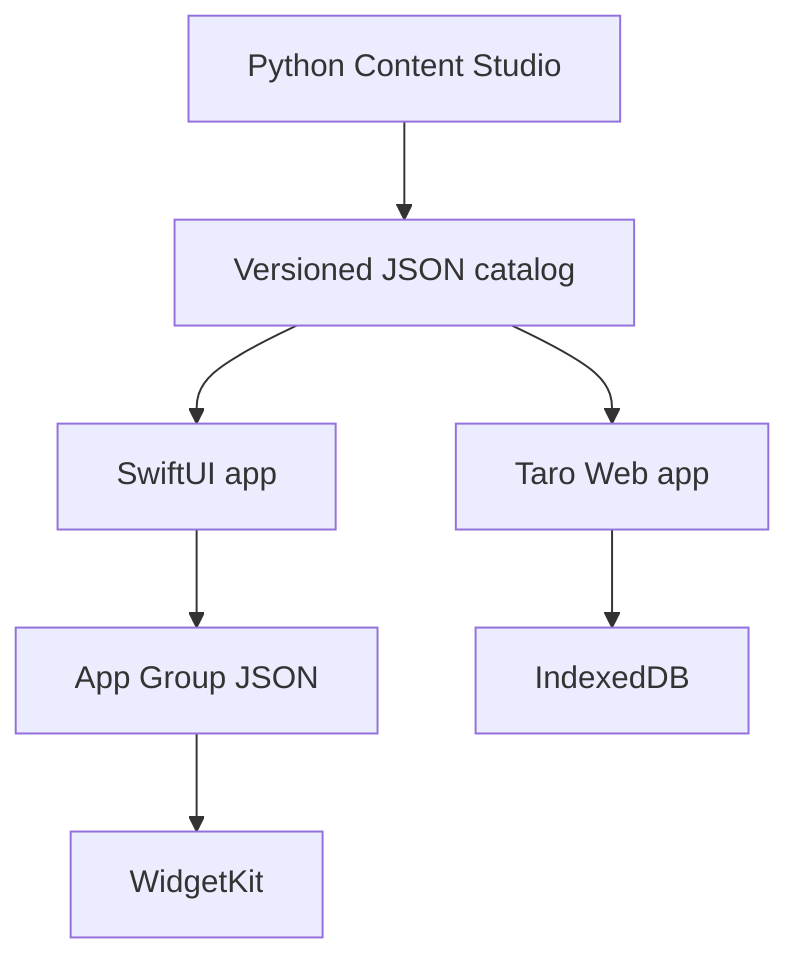

# Rain House

I built Rain House to save lyrics, rank favorite songs, and keep a diary of live shows. The native iOS app includes Home Screen and Lock Screen widgets, and the Web app adapts to mobile and desktop browsers.

[Open Rain House on the Web](https://rainhouse.top)

## iOS product design

  
  

  
  

## Implementation

- **iOS** — Swift and SwiftUI for the app, with a shared Swift package for the catalog, local persistence, and Elo ratings. WidgetKit reads daily lyrics and concert countdowns from shared App Group data.
- **Web** — TypeScript, React, and Taro for a responsive H5 app with browser storage and file adapters. I deployed the build on Cloudflare Pages and migrated the production site to EdgeOne Pages. [Desktop dashboard](assets/web-desktop-dashboard.webp)
- **Content Studio** — A local Python tool for searching and editing releases, songs, concerts, and ordered setlists. It validates catalog references and keeps a journal for restoring prior revisions. [Setlist editing demo](assets/catalog-workflow.mp4)

## Database Design & Data Management

The clients start with a bundled JSON catalog. On iOS, the app writes personal state as JSON and shares a snapshot with the widgets through an App Group. The Web app stores a versioned personal document in IndexedDB. JSON backup export and restore support manual transfer of compatible iOS data to the Web.

Catalog model, storage options, and backup

- **Music catalog** — An album contains songs. Lyric records refer to a song by `catalogSongID`, and excerpts link by `songID` with a `dailyEligible` flag for selection.
- **Concert catalog** — A setlist links to a concert by `concertID` and contains ordered sections. Each entry can reference a song or use a manual title. In a fictional example, `demo-show-1` links to a setlist whose Opening section references `demo-track-1`, “Paper Lanterns.”
- **Personal state** — Favorites reference excerpt IDs, ratings are keyed by song ID, and concert memories are keyed by event ID. Supported iOS builds can store a JSON document in iCloud Drive and mirror a snapshot to the App Group.
- **Publishing and accounts** — The catalog publisher supports versioned snapshots on Tencent Cloud COS with hash verification and rollback. The live Web deployment serves its bundled catalog. I used CloudBase Auth and PostgreSQL-backed Storage for avatars in a separate account preview.

[Web backup controls](assets/web-mobile-backup.webp) · [Studio setlist editor](assets/studio-setlist-editor.webp) · [Studio history and restore](assets/studio-history.webp)

The Rain House app and Content Studio source code are private.
